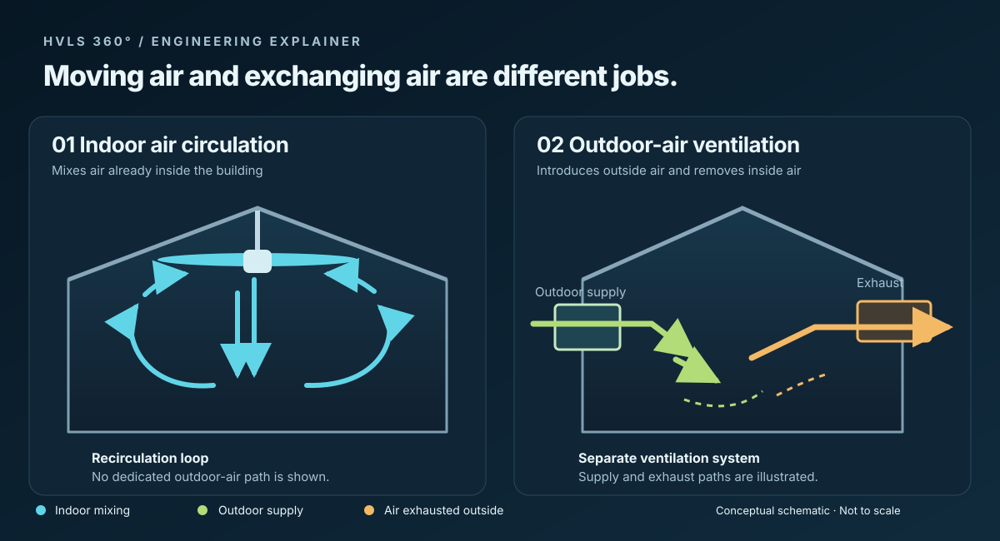

# HVLS Fans, Air Movement and Ventilation: What Facility Managers Need to Know

A ceiling fan can make a warehouse feel more comfortable without bringing in any outdoor air. That matters when a facility is buying fans to solve complaints about heat, stagnant air or indoor air quality. Each complaint calls for a different assessment; moving more indoor air does not answer all three.

## What workers feel

Air moving across a person can increase convective and evaporative heat transfer. A comfort claim expressed as “degrees cooler” therefore needs an explanation: what air speed, humidity, temperature, clothing and activity were assumed? It does not mean the room's dry-bulb temperature fell by that amount.

Big Ass Fans discusses these factors in its *Ceiling Fan Design Guide* [1]. ASHRAE Standard 55-2023 provides a broader thermal-comfort framework [5]. DOE's reminder that fans cool people rather than rooms is a useful introduction, although its home-cooling example is not an industrial design method [2].

For a facility specification, describe the occupied work areas and the comfort conditions the design is intended to address. A catalog's perceived-cooling figure needs its supporting conditions before it can serve as a project target.

## Check the temperature above the work floor

In a tall heated building, warmer air can collect near the ceiling while workers remain cold below. Ceiling fans can mix that air to reduce the vertical temperature difference; Big Ass Fans covers this use in its design guide [1].

Take temperature readings at several elevations before deciding how to operate the fans. Record thermostat locations, heating equipment and fan settings. After changes, repeat the survey under comparable conditions. Door use, insulation, heating controls and operating hours all affect the result, so a savings percentage from another building is not a reliable guarantee for this one.

## Where the outdoor air comes from

EPA identifies natural ventilation, infiltration and mechanical outdoor-air intakes or exhaust as pathways for outdoor air [3]. Its overview is largely residential background. A commercial ventilation design needs criteria for the actual occupancy and any contaminants or processes involved.

ASHRAE Standard 62.1-2025 addresses ventilation and acceptable indoor air quality, including outdoor air, filtration, controls and operation [4]. The edition adopted for a job may differ from the latest published edition. Confirm the applicable requirements with the design team and jurisdiction.

An HVLS fan can influence distribution within that design. It does not supply the outdoor air or capture contaminants at their source. Any proposal to use fans in place of required ventilation or source capture needs a specific engineering basis.

## Write down how success will be measured

For comfort, assess conditions where people work. For destratification, compare temperatures at different heights. For ventilation, establish the outdoor-air and contaminant-control design separately.

The installation submittal also needs the exact model's structural attachment, clearances, electrical supply and controls, including sprinkler or fire-system coordination where applicable. Commissioning should record the required control and shutdown behavior as well as operation of the fan.

When a study is offered as evidence, look for its baseline, measured results, setpoint changes, building type and sponsorship. Those details determine how useful it is to the next facility. Agree on the project's own acceptance measurements before ordering equipment.

### Sources

[1] Big Ass Fans, *BAF Ceiling Fan Design Guide*, especially sections 2.1 (Thermal Comfort) and 2.4 (Ceiling Fan Use in Heating): https://learn.bigassfans.com/design-guide

[2] U.S. Department of Energy, *Top 11 Things You Didn't Know About Saving Energy at Home: Summer Edition*: https://www.energy.gov/articles/top-11-things-you-didnt-know-about-saving-energy-home-summer-edition

[3] U.S. Environmental Protection Agency, *How does outdoor air enter a building?*: https://www.epa.gov/indoor-air-quality-iaq/how-does-outdoor-air-enter-building

[4] ASHRAE, *Standard 62.1-2025, Ventilation and Acceptable Indoor Air Quality* (official overview): https://www.ashrae.org/technical-resources/bookstore/standards-62-1-62-2

[5] ASHRAE, *Standard 55-2023, Thermal Environmental Conditions for Human Occupancy* (official overview): https://www.ashrae.org/technical-resources/bookstore/standard-55-thermal-environmental-conditions-for-human-occupancy
