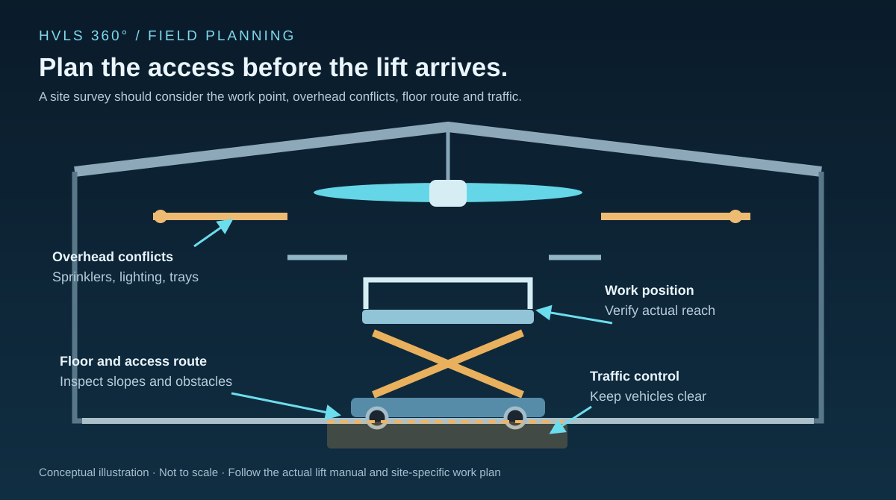

# Before the First Blade Goes Up: Scissor Lift Planning for HVLS Installations

A fan installation can be correctly engineered and still lose a day because the lift cannot reach the work. Warehouse aisle widths, slab conditions, overhead obstructions and operating forklift traffic all influence access long before a motor or blade is raised. OSHA's scissor-lift guidance identifies fall protection, stabilization and positioning as recurring safety concerns—three useful checks for an HVLS site survey [1].

## Measure the route and the working envelope

A fan diameter and mounting height do not tell you everything about the lift required. The crew must reach the mounting connection, motor assembly, blade attachment points and electrical or control work without climbing guardrails or leaning beyond the platform. OSHA advises keeping work within easy reach and standing only on the work platform [1].

Before booking equipment, record the finished-floor-to-work-point height, overhead obstacles, platform access route and the actual tasks at each position. A lift that reaches the bottom of the fan may not provide workable access to the upper mounting hardware. A platform that can reach the height may still be too wide to pass through a door or between installed machinery.

Maximum platform height alone does not establish a usable work position. Verify the selected lift's platform dimensions, capacity, reach and operating limitations in its exact manufacturer manual.

## The slab and travel path matter

Industrial facilities can have trench covers, floor drains, uneven expansion joints, dock transitions, slopes and temporary construction debris. OSHA's guidance calls for firm, level surfaces away from holes, drop-offs and other conditions that threaten stability [1].

The crew should inspect the intended route and every elevated work location. Verify the equipment's allowable surface conditions and whether it can travel while raised. OSHA notes that manufacturer instructions commonly restrict moving scissor lifts in the elevated position [1]; this is not a universal permission or prohibition for every model.

Workers, tools, components and materials all count toward the rated platform load. An HVLS hub or motor assembly may need a separate lifting plan; the scissor lift should not be treated as a crane simply because it is already on site.

## Overhead clearance and active traffic

At the roof, the hazard isn't limited to the fan structure. Sprinkler piping, light fixtures, cable trays, overhead doors and nearby equipment can become crush or entrapment hazards as the platform rises.

OSHA specifically addresses positioning around fixed objects, moving equipment and electrical sources [1]. For an active distribution center, a traffic-control plan can be as important as the lift itself. Forklifts and other vehicles should not be able to enter the lift's operating area unexpectedly.

A ground guide may help with movement through congested areas, but does not replace a trained operator or a proper exclusion zone. Coordinate the work with facility operations, particularly where production continues around the installation.

## Match protection and training to the lift

OSHA's scissor lift alert emphasizes installed guardrails, trained workers and safe platform behavior [1]. It cites applicable OSHA guardrail provisions, but site-specific requirements, manufacturer instructions and the employer's hazard assessment still govern the work.

Avoid importing a blanket rule from boom lifts into every scissor lift job. The equipment categories differ, and fall-protection arrangements can depend on the lift, task and applicable requirements. Operators should be trained for the actual equipment and work conditions.

The same applies to outdoor work. OSHA's hazard alert describes wind as a serious instability factor and notes that many outdoor-rated scissor lifts have wind restrictions [1]. The exact machine's rating and instructions—not a generic number from a blog—must control the decision.

## The access survey belongs in the bid

A useful HVLS access survey should capture:

- The actual working elevations and overhead clearances at each installation point.
- The access route, doors, aisle widths and floor conditions.
- Platform load requirements for workers, tools and components.
- Nearby forklift traffic, energized equipment and other work crews.
- Whether a separate material-hoisting method is needed.
- The exact lift model, manual, inspection requirements and trained operator availability.

This checklist is not a replacement for a lift-specific job hazard assessment. Its value is making access planning part of the installation design rather than a surprise on arrival.

## Resolve access before mobilization

Include the access survey with the installation estimate. If the proposed lift cannot reach a mounting connection, pass through an aisle or carry the planned load within its rating, the installation method and rental allowance need revision before the crew arrives.

### Sources

[1] U.S. Occupational Safety and Health Administration, *Working Safely with Scissor Lifts*, OSHA 3842: https://www.osha.gov/sites/default/files/publications/OSHA3842.pdf

### Editorial verification record

- **Primary source:** OSHA's official scissor-lift hazard alert reviewed for fall protection, stability, positioning, inspection and training.
- **Scope:** General U.S. workplace guidance applied to HVLS installation planning; no claim that OSHA reviewed a particular fan installation.
- **Technical review:** Verify language about lift movement, fall protection and material handling with a qualified access-equipment reviewer before release.
- **Media:** Original site-access planning diagram or licensed real field photograph can be added after review.
- **Publisher approval:** Not requested.
