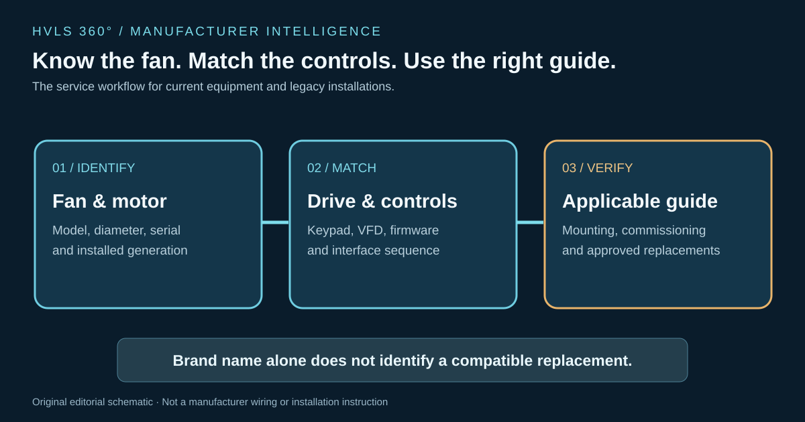

# VividAir and Go Fan Yourself: The Z-Tech, TAZ and Controls Questions Installers Should Ask

For technicians who have worked with Go Fan Yourself equipment, **VividAir** is a name worth tracking. The Go Fan Yourself product site now directs visitors seeking TAZ information to VividAir's product pages, where current brochures, specifications and installation guides are posted [1][2]. That connection matters to installers and service contractors trying to match a fan on the ceiling with the correct documentation.

The immediate story isn't a new performance record. It's a practical one: **which fan family is installed, which generation of controls is present, and which manual applies?** Those questions become more important as a manufacturer's product line and branding evolve.

## Z-Tech: the large-diameter workhorse

VividAir's current Z-Tech product page lists nine standard fan diameters from **8 to 24 feet** and describes a pitched-blade system intended for large warehouses and manufacturing facilities [2]. It also advertises a Z-Chill upgrade path and publishes a Z-Tech specification sheet dated November 2025, a January 2023 installation and technical operations guide, and an October 2026 sell sheet [2].

That document trail is useful, but not interchangeable. A current sell sheet may describe a controller or option that differs from the one installed years earlier. Before replacing a drive, keypad or motor component, identify the actual fan and control hardware, record its labels and compare the applicable technical guide with the supplied submittal.

The older Go Fan Yourself Z-Tech page describes a product partnership involving ABB and a Dodge Quantis Z-Tech drive system [3]. That historical description is relevant to legacy service work; it does **not** establish that every current VividAir Z-Tech fan uses the same exact drive, firmware or control arrangement.

## TAZ: the answer when the ceiling won't cooperate

TAZ is a different installation problem from a conventional large-diameter ceiling fan. VividAir positions the product for **aisles, mezzanines and obstructed ceiling areas**, with 36-inch and 72-inch variants [1]. The current TAZ page links separate installation guides for the two sizes, including a January 2023 guide for the 72-inch model [1].

The field questions change accordingly. An installer needs to establish the mounting orientation, surrounding obstructions, air-discharge direction and whether the desired coverage is along an aisle or across an open floor. A TAZ layout should not be treated as a simple substitution for a 20-foot overhead HVLS fan based on a headline airflow number.

VividAir advertises up to 135 feet of linear cooling coverage and up to 75,200 CFM for the TAZ family [1]. Those are **manufacturer-published figures**, not independently reproduced measurements by HVLS 360°. A facility comparison needs the exact size, operating point, test method, installation configuration and intended occupant area.

## The controls are part of the product

VividAir's current Z-Tech page identifies **VividAir Navigator** as a platform for centralized individual and group fan control [2]. The historical Go Fan Yourself Z-Tech page highlights ABB-based system components [3].

Neither statement is enough to design a retrofit from a distance. A service technician should document the actual keypad, controller, drive nameplate, motor, communications wiring and any building-management or fire-alarm interface before recommending a replacement.

A recurring mistake in the large-fan business is to assume that a VFD with the right input voltage and horsepower can be substituted without considering the fan manufacturer's motor characteristics and safety/control sequence. The exact OEM-approved combination and documentation govern the work. This is particularly relevant where a site has a mixture of older GFY installations and newer VividAir equipment.

## Product claims deserve a fair, testable comparison

The current VividAir product lineup includes Z-Tech, Z-Tech3, TAZ, Z-Chill and other air-movement products [4]. The company describes ambitious coverage, comfort and efficiency benefits. A serious buyer should ask how each claim was measured.

For cooling comfort, distinguish air speed and occupant sensation from actual reduction of room air temperature. For destratification, ask about ceiling and occupied-zone measurements before and after operation. For efficiency, compare equivalent operating conditions and recognized ratings rather than unlike maximum-airflow figures.

These questions apply just as much to Big Ass Fans, MacroAir, Greenheck and every other manufacturer. Credible product intelligence should neither repeat promotional claims as independent results nor dismiss a product without evidence.

## What installers should request before mobilizing

For a new or existing VividAir/GFY installation, the useful starting package includes:

- Exact model, diameter, serial information and manufacturing generation.
- Applicable installation and technical operations guide for that specific fan.
- Drive and motor nameplates, controls hardware and software revisions where available.
- Structural mounting requirements and the actual building attachment details.
- Fire-alarm, building-controls and group-control sequence documentation.
- Commissioning and maintenance instructions for the installed configuration.

The goal is not paperwork for its own sake. It is preventing an avoidable return trip caused by an incompatible part, outdated drawing or misunderstood control sequence.

## Bottom line

**VividAir deserves dedicated technical coverage because its current product documentation and the Go Fan Yourself legacy both matter in the field.** The useful story is how to identify and support the exact system—not which brand has the loudest airflow claim.

HVLS 360° will continue tracking the Z-Tech family, TAZ, Navigator controls and product-document revisions, with original source links and model-specific technical checks.

### Sources

[1] VividAir, *TAZ product page*, including 36-inch and 72-inch technical guide links: https://vividairmovement.com/product/taz/

[2] VividAir, *Z-Tech product page*, including current product literature and technical guides: https://vividairmovement.com/product/z-tech/

[3] Go Fan Yourself, *Z-Tech product page*, including historical ABB system references: https://gofanyourself.com/products/z-tech-fan/

[4] VividAir, *Current products and product families*: https://vividairmovement.com/products/

### Editorial verification record

- Manufacturer primary sources reviewed November 10, 2026; GFY's TAZ product URL resolves to VividAir.
- Brand relationship is established through cross-linked product pages; no unsupported claim about the legal timing or ownership of a rebrand.
- VividAir performance claims are attributed to the manufacturer; no independent airflow or temperature measurements were performed.
- Technical review required for exact model generations, drive compatibility, mounting and controls.
- Original illustration requires technical artwork review. No manufacturer photo rights claimed.
- Publisher approval not requested.
